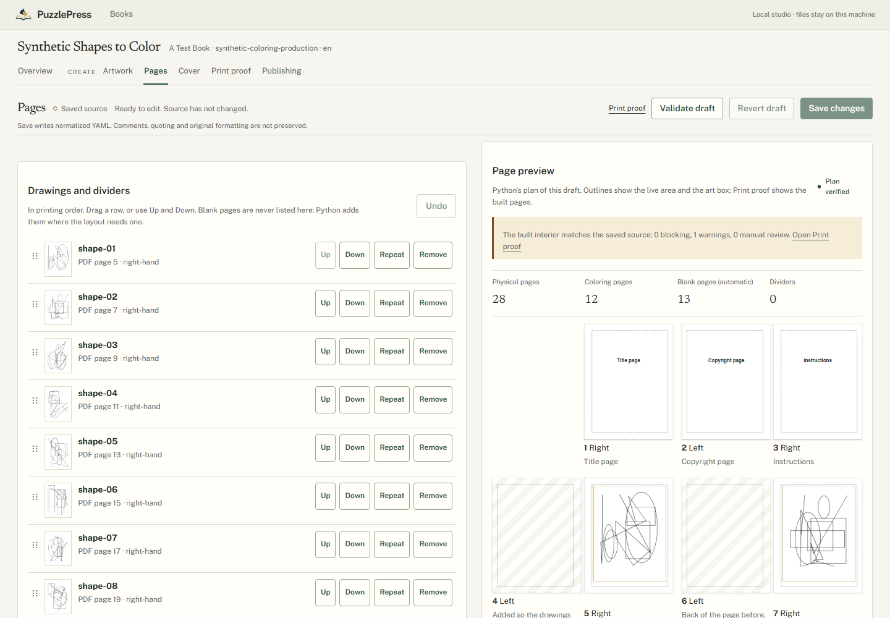
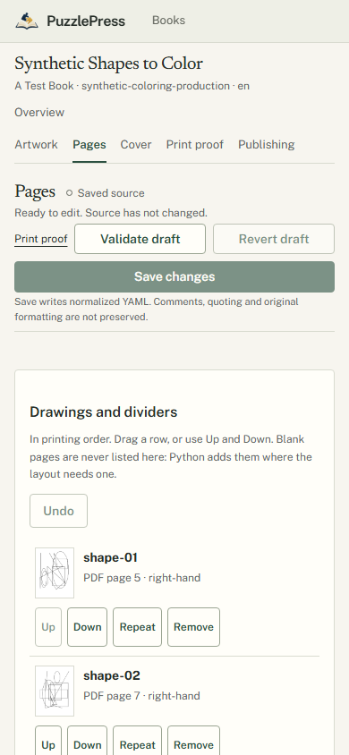
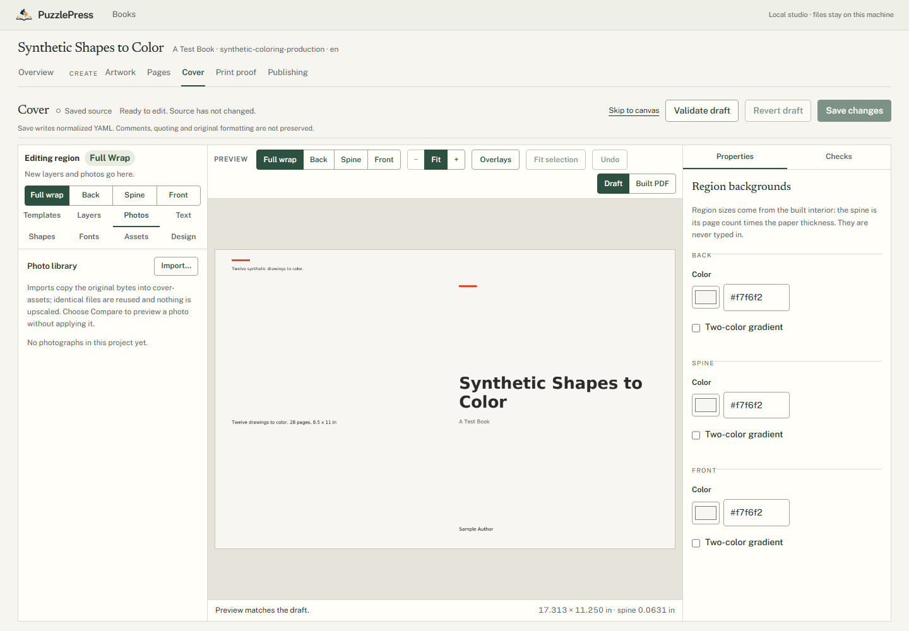
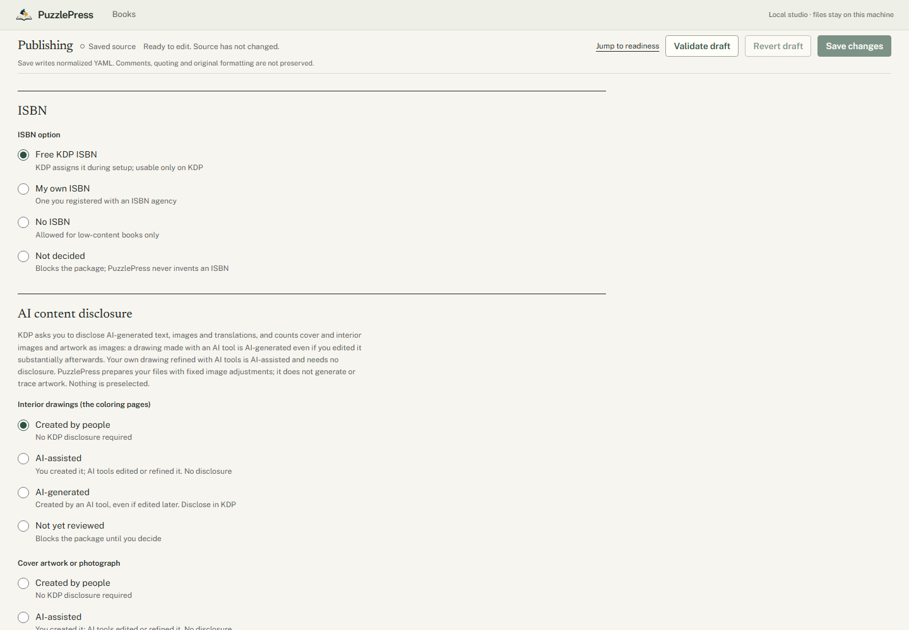

# Creating and Publishing a Coloring Book with PuzzlePress

This guide takes one coloring book from an empty folder to a package you upload to
Amazon KDP yourself. PuzzlePress never contacts, logs in to or submits anything to
Amazon. A ready package means the checks PuzzlePress models passed and you made the
declarations only you can make; KDP reviews the book and decides.

Every step works from the CLI and from Studio (`puzzlepress-studio --books DIR`).
Reference: [coloring.md](coloring.md) (artwork, preparation, interior, preflight),
[cover.md](cover.md), [publishing.md](publishing.md#coloring-books),
[production-run.md](production-run.md#coloring-books).

## 1. New project

A coloring book is a folder holding `book.yaml` with a `coloring` section:

```yaml
schema_version: 1
book: {id: woodland-coloring, title: Woodland Coloring, author: A. Artist, language: en}
build: {seed: 1}
output: {directory: ../../build/woodland-coloring}
coloring: {version: 1}
```

`puzzlepress inspect BOOK` shows `Engine: coloring (Coloring book)`. Keep the
output directory outside the book folder; PuzzlePress refuses to write inside it.

## 2. Artwork import

```text
puzzlepress coloring import BOOK drawings/*.png
```

or **Artwork > Import** in Studio. PNG (preferred) or JPEG, black lines on white,
at least 2175 x 2925 px for a full page at 300 DPI. Originals are copied
byte-for-byte into `coloring-assets/` under a content-addressed name and are never
written again; a batch is all-or-nothing. Each file is inspected (pixels, DPI at
the art box, color, gray paper, transparency, edges) and compared with the others
for duplicates. Import adds each drawing to the page list.

## 3. Preparation

Each drawing keeps its own preparation settings (gray conversion, invert,
brightness, contrast, background cleanup, despeckle, threshold, line weight).
Preparation is configuration: the prepared pixels are derived in memory and the
original is untouched. In Studio, **Artwork > Prepare line art** shows the
original, the prepared page and a difference view (red: ink removed, blue: ink
added, orange: light strokes erased) with measured findings. From the CLI:

```text
puzzlepress coloring prepare BOOK fox --set contrast=1.3 --output previews/
puzzlepress coloring adjust BOOK fox --set contrast=1.3
```

Watch for `faint_strokes_erased`: pencil lines and soft detail lighter than ink
that the settings stop printing. Erasing construction lines may be what you want;
erasing detail is not. Findings are measurements, not judgements.

## 4. Page organization

In Studio, **Pages** lists drawings and section dividers in printing order. Drag a
row or use **Up** and **Down**; **Add drawing at the end**, **Repeat** (use a drawing
again on purpose, flagged), **Remove** (the file stays in the library), **Add
section divider** (title and optional description). The front matter (title page,
copyright notice you write yourself, instructions), back matter, blank backs,
border, recto start and page numbering are on the same page. **Undo** steps back
through your edits; **Save changes** writes `book.yaml` atomically and refuses if the
saved file changed meanwhile.

The preview is Python's plan of your draft: physical PDF pages as spreads, right-
and left-hand pages, every blank page PuzzlePress inserted and why (the back of a
coloring page, or to start drawings on a right-hand page), the printed numbers, and
the live area and art box. Blank pages are never authored; they follow from the
layout. The same plan from the CLI: `puzzlepress book plan BOOK`.




## 5. Interior generation

```text
puzzlepress book build BOOK
puzzlepress book preflight BOOK
```

or **Print proof > Build** in Studio. Each drawing is prepared from its verified
original and embedded losslessly (1-bit or 8-bit gray, Flate), fitted whole into
the art box, never cropped or resampled. The PDF is reopened and every image is
decoded and compared with its prepared pixels. Preflight runs
`puzzlepress-kdp-coloring` v2: page boxes, margins, fonts, parity of coloring
pages and blank backs, image integrity, 300 DPI, line quality. Print proof shows
every built page with overlays, findings grouped as blocking, warnings and manual
review, and **Download interior.pdf**.

## 6. Cover design

The cover is the shared Cover Studio (`cover` section, see [cover.md](cover.md)).
It is sized from the built interior: page count read from `interior.pdf`, paper
from the print profile, spine width = pages x the paper's thickness, bleed, safe
areas and the barcode area from KDP's values. Build the interior first; a changed
page count makes the cover out of date until it is rebuilt.

In Studio, **Cover > Templates** applies a design without touching book details.
Text may use `{title}`, `{subtitle}`, `{author}`, `{imprint}` and `{artwork_count}`
(filled in when the template is applied) and the live `{page_count}` and
`{trim_size}` (filled in by Python every time the cover is laid out, from the
built interior). Import a cover drawing or photograph in **Cover > Photos**; the
cover's own pixels carry no source metadata. Then:

```text
puzzlepress cover build BOOK
puzzlepress cover preflight BOOK
```



## 7. Metadata

**Publishing** in Studio, or the `publishing` section of `book.yaml`. Besides the
shared fields (description, keywords, categories, audience, low-content, ISBN,
edition, series), a coloring book declares:

- **Who made the artwork** (`ai_disclosure.interior_artwork`, `cover_artwork`):
  human, AI-assisted (your own drawing refined with AI tools: no KDP disclosure)
  or AI-generated (made by an AI-based tool, even if you edited it substantially:
  disclose in KDP). KDP asks one images question for cover and interior together,
  so `images` must match the more disclosing of the two.
- **On what basis you may publish it** (`content_rights`): own work, commissioned,
  licensed, public domain or AI tool terms, for the interior artwork, the cover
  artwork and the text. Having a file is not a right to publish it.
- **Low-content**: KDP lists coloring books as "not generally low-content". If you
  choose low-content anyway, PuzzlePress enforces what KDP states (no free ISBN, no
  series).



Nothing is preselected and undecided values block. PuzzlePress never invents an
ISBN, a declaration or a confirmation. List price and markets are set in KDP.

## 8. Preflight

```text
puzzlepress publish validate BOOK      # metadata, declarations, confirmations
puzzlepress publish inspect BOOK       # plus fresh interior and cover preflight
```

Readiness reruns both preflights on the files as they are and never trusts saved
reports. Confirm the three statements (rights, AI disclosure, metadata) in
Studio's Publishing page after reviewing what each covers; a confirmation records
exactly what you reviewed and goes stale when that changes (reordering pages does
not; replacing or retitling a drawing does).

## 9. Production package

```text
puzzlepress book produce BOOK --output release/
```

One verified, all-or-nothing run: interior and preflight, cover and cover
preflight, `artwork-integrity.json`, `artwork-duplicates.json`/`.md`, readiness
and KDP metadata, `publishing-validation.json`/`.md`, `production.json`, and
`publishing/` (the upload package) only when nothing blocks. The run is staged
beside `release/` and swapped in only after every file is read back; a failed run
leaves the previous release untouched. Exit 0 only with no blocking item.

An example from the synthetic test book (`python tests/coloring_production.py
DIR` writes it, with SYNTHETIC declarations made for no real author):

```text
release/
  artwork-duplicates.json   artwork-duplicates.md   artwork-integrity.json
  cover-preflight.json      cover.json              cover.pdf
  interior.json             interior.pdf            preflight.json
  kdp-metadata.json         publishing-readiness.json
  publishing-validation.json  publishing-validation.md  production.json
  publishing/
    cover-preflight.json  cover.pdf  interior-preflight.json  interior.pdf
    kdp-checklist.md  metadata.json  package.json  provenance.json  readiness.json
```

## 10. Manual review and KDP submission

Automated checks cannot judge a drawing or guarantee acceptance. Before you
submit:

1. Read `publishing-validation.md`: no blocking items; decide on every warning.
2. Look at every page at print size (Print proof or the PDF): line weight, faint or
   broken strokes, clipped details, dense dark areas, whether it is good to color.
3. Keep the evidence behind your rights declaration (licences, agreements, AI tool
   terms).
4. Follow `publishing/kdp-checklist.md` in KDP: enter the metadata, answer the AI
   question for text and images from your declaration, upload `interior.pdf` and
   `cover.pdf`, and review every page in KDP's Print Previewer.
5. Order a printed proof: thin and light lines print differently on paper.
6. Submit yourself when satisfied. KDP then reviews the book.

## Real-artwork review

PuzzlePress's thresholds were calibrated on synthetic drawings only; no genuine
coloring artwork was available to this engine. Until a person has reviewed real
artwork this way, treat every line-quality result as provisional:

1. Choose a small set you have the rights to use for testing, covering: detailed
   automotive or mechanical line art, nature or landscape drawings, pencil-style
   drawings, dense patterns, thin outlines, and light or low-contrast strokes.
2. Import them into a scratch book (never the real book) and build the interior
   with default settings.
3. For each drawing, compare original, prepared and difference views at 100 %
   zoom; note any loss of fine or light lines, background tint, broken outlines,
   clipped details, overly dark areas and unbalanced line weights, and whether
   PuzzlePress reported each one.
4. Adjust settings until the page looks right; record the settings and whether a
   finding appeared that should not have, or did not appear when it should.
5. Order one printed proof of the scratch book and repeat step 3 on paper.
6. Record the results (file, source and licence, settings, findings, what the eye
   saw on screen and on paper) and update the thresholds only from that evidence.

## Measurements

Windows, Python 3.13, synthetic full-size line art (2175 x 2925 px), the same
machine and an otherwise idle system for both columns. Each 150-drawing row builds
and then preflights in one process, as `book produce` and Studio do. (Interval 4
recorded 19.7 s and 92.8 s for the same book on a less loaded day; compare columns,
not days.)

| Book | Step | main (Interval 4 code) | Interval 5 |
| --- | --- | --- | --- |
| 12 drawings, 28 pages, cover and publishing | `book produce` | refused | 24.5 s with the memo disabled, 14.3 s with it; byte-identical output |
| 150 drawings, 302 pages | `book build` | 20.2 s | 20.3 s |
| 150 drawings, 302 pages | first preflight after the build | 122.9 s | 100.6 s |
| 150 drawings, 302 pages | second preflight, same process | 118.4 s | 14.9 s |
| 150 drawings, 302 pages | peak working set (build + both preflights) | 147 MB | 141 MB |
| 150 drawings, 302 pages | `book produce` (no cover or publishing; blocked as expected) | refused | 125.1 s, 120 MB peak |

The first preflight is faster because its expected rebuild reuses the packed pixels
the build just prepared; the second, because every drawing's measures are already
known. Each light-stroke measure is skipped exactly when an original has too few
gray 129-200 pixels to be measured, so line art without them pays nothing for it.

The memo reuses line-quality measures and packed prepared pixels for the same
verified bytes, settings and versions within one process; it skips no check and
writes nothing to disk. A first preflight still measures every drawing.

## Known limitations

- One trim (8.5 x 11 in, white or cream paper), no bleed: art prints inside the
  margins. No auto-crop, captions or per-page placement.
- No graphical illustration editor; preparation is a fixed set of adjustments.
- Line-quality thresholds are synthetic-calibrated conventions; see Real-artwork
  review. Light-stroke detection cannot tell construction lines from detail.
- Coloring PDFs are byte-reproducible only with the same zlib and Pillow.
- KDP's form wording for the AI question, prices and markets are not modeled.
- Categories are saved preferences, never verified as available.
