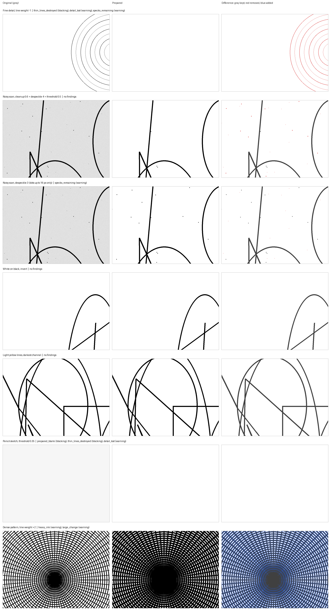
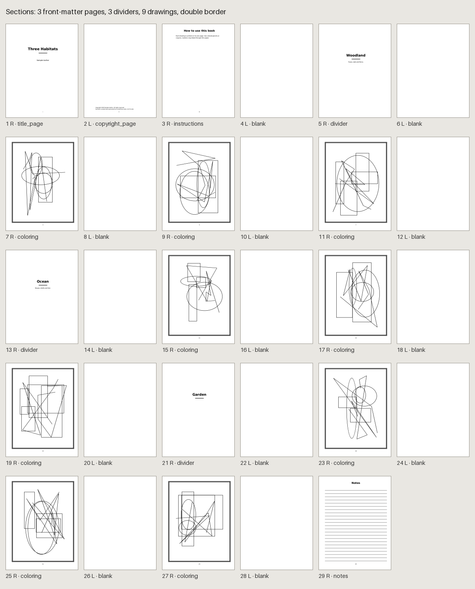
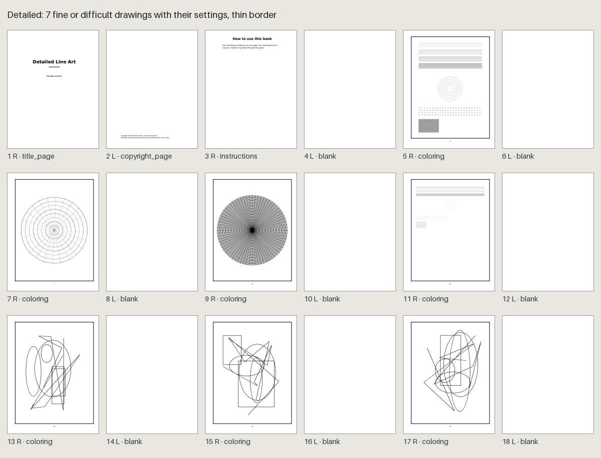
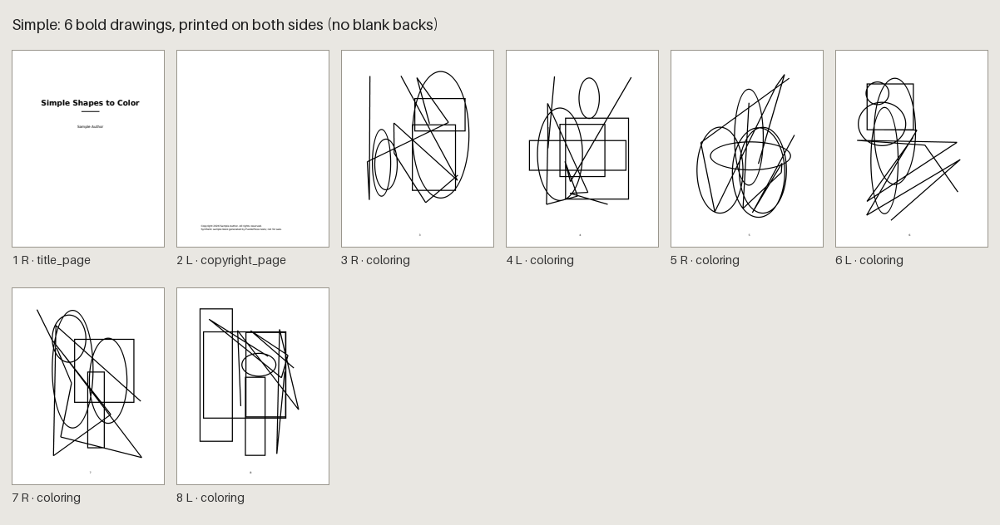
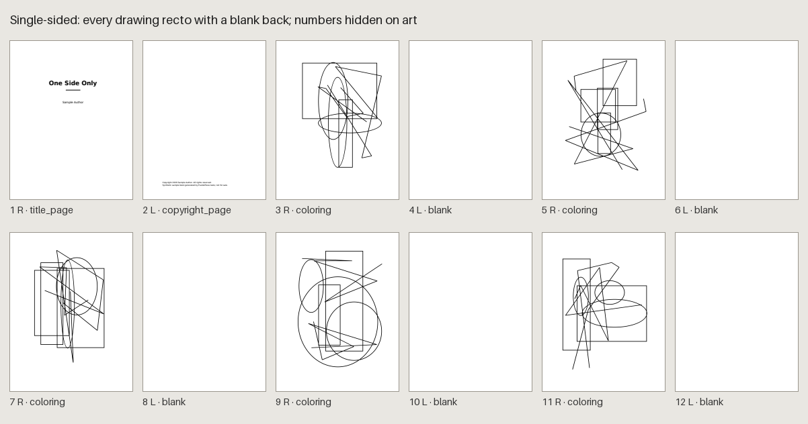

# Coloring books: artwork, preparation, composition and interior

This version can represent a coloring book, import, inspect and de-duplicate its
artwork, prepare line art for black-ink printing, compose the book (front matter,
section dividers, blank reverse pages, page numbers), build a deterministic PDF
interior from the prepared pixels and preflight it, design its cover, record its
publishing metadata and rights declarations, and produce a verified KDP package,
from the CLI or Studio. The end-to-end walkthrough is
[Creating and Publishing a Coloring Book](coloring-publishing.md). Interior style
sections (word-search typography) stay refused for coloring books
(`not_available_for_engine`). Plan: [multi-engine-plan.md](multi-engine-plan.md).

## Source

A coloring book is a schema-v1 `book.yaml` with a `coloring` section instead of
`word_search`. The two together fail `engine_conflict`. The engine kind is derived,
never written: `inspect` shows `Engine: coloring (Coloring book)`.

```yaml
schema_version: 1
book: {id: woodland-coloring, title: Woodland Coloring, language: en}
build: {seed: 1}
coloring:
  version: 1
  artwork:
    - id: fox-in-the-ferns
      path: coloring-assets/fox-in-the-ferns-0dfcb86a26ec.png
      sha256: 0dfcb86a26ece8601d11ec6894c84b3f3edcacdd74ad04011dafa092eacbe51e
      title: Fox in the Ferns            # optional, one line, <=200
      adjustments:                       # optional; see Line-art preparation
        grayscale: true                  # luma; false: darkest channel
        threshold: null                  # null or 0.05..0.95
        brightness: 0.0                  # -1..1
        contrast: 1.0                    # 0.25..4
        background_cleanup: 0.0          # 0..1
        despeckle: 0                     # 0..5
        line_weight: 0                   # -2..2
        invert: true                     # optional; written only when true
  pages:                                 # publication order
    - {divider: {title: Woodland, text: Animals of the forest.}}   # optional
    - {artwork: fox-in-the-ferns}
    - artwork: fox-in-the-ferns          # optional placement (see Interior)
      placement: {scale: 0.8, x: 0, y: 1}
  layout:
    blank_reverse: true                  # default: single-sided, blank backs
    border: none                         # none | thin | double
composition:                             # required to plan or build
  front_matter:                          # title_page, copyright_page, instructions
    - {kind: title_page}
    - {kind: copyright_page, text: "Copyright 2026 ..."}
  artwork: {start: recto}                # recto (default) | any
  back_matter: []                        # about, notes
  page_numbers:
    scheme: continuous                   # continuous | roman_front_matter
    show_front_matter: false
    show_artwork: true                   # numbers on coloring pages
    show_back_matter: true
```

| Rule | Code |
| --- | --- |
| `version` must be 1 | `unsupported_version` |
| Artwork IDs: lowercase letters/digits and hyphens, <=64, unique | `id`, `duplicate_id` |
| `path` is `coloring-assets/<stem>-<12 hex>.png\|jpg`: no other folder, no `..`, no backslash | `path` |
| `sha256` is 64 lowercase hex digits and starts with the name's 12 hex | `sha256`, `sha256_mismatch` |
| Pages name existing artwork; an artwork may be on several pages (reported as a duplicate) | `unknown_artwork` |
| A divider has a one-line title (<=200) and optional text (<=600, line breaks allowed) | `required`, `text` |
| `placement` (drawings only): `scale` 0.5..1, `x` and `y` -1..1, 4 dp; centred `{1, 0, 0}` is written as none | `range`, `type`, `unknown_field` |
| At most 300 artwork and 300 page entries | `count` |
| Composition: puzzle and solution settings (`puzzles`, `solutions`, `show_solutions`) do not apply | `not_applicable_for_engine` |
| No `interior` style section (covers and publishing are shared sections) | `not_available_for_engine` |

Defaults are normalized, so omitted and explicit values hash equally. The section
and the composition are part of build identity (envelope `coloring_version: 1`,
`composition_version: 1`); artwork enters by its pinned SHA-256 and settings, never
by reading files. Word-search projects serialize exactly as before and keep their
identities: a coloring composition serializes only front matter, `artwork`, back
matter and page numbers (with `show_artwork`, never `show_solutions`).

## Artwork requirements

- PNG (preferred) or JPEG, detected by content, not by extension. At most 64 MB
  and 80 megapixels. 8-bit modes only (1, L, LA, P, RGB, RGBA, CMYK).
- SVG is refused (`svg_not_supported`): vector files can carry scripts and remote
  references, and there is no safe SVG renderer yet. Export a PNG instead.
- Full-page art needs at least 2175 x 2925 px: 300 DPI over 7.25 x 9.75 in, the
  live area of the 8.5 x 11 in profile. Inspection measures against that area. A
  built page prints the drawing inside the art box (see Interior), which is smaller,
  so the printed DPI is at least the inspected one.
- Black lines on white. Color, gray paper and transparency are reported, not
  converted.

## Import and storage

Originals are copied byte-for-byte into the project's `coloring-assets/`
under `<stem>-<sha12>.<ext>`. The stem is an ASCII slug of the file name (accents
folded, anything else a hyphen; `artwork` when nothing is left); the title keeps the
original Unicode name. Directory parts of a name are ignored. Identical bytes are
stored once, under any name. A different file already holding the target name is
refused (`asset_collision`), never replaced.

A batch is all-or-nothing. Every file is decoded and inspected first, and one
failure refuses the batch with every failing file listed. Then files are staged,
fsynced, read back and linked into place (never over an existing file), and
`book.yaml` is replaced once, revision-checked (`source_changed` if it changed
meanwhile). If that write fails, files the batch created are removed. Re-importing
bytes the library already holds adds nothing. `import` and `remove` rewrite
`book.yaml` canonically: comments and formatting are not preserved.

Every read re-checks that `coloring-assets/` is a real directory directly inside the
resolved project (`asset_unsafe` otherwise) and that the bytes still match the
pinned digest (`artwork_changed`, `artwork_missing`). One project never reads another
project's files.

## Inspection

Facts: SHA-256, format, bytes, color mode, stored and upright pixels (EXIF
orientation), aspect ratio, alpha channel, transparent pixels, DPI metadata
(recorded, never trusted), effective DPI and printed size fitted whole inside the
live area, share of the area filled, ink coverage, background level, color, and a
64-bit difference hash. Measures use a box-reduced copy (at most 1,024 px) and are
rounded, so reports are deterministic for a given Pillow version.

| Finding | Severity | When |
| --- | --- | --- |
| `artwork_resolution_too_low` | blocking | under 150 DPI |
| `artwork_empty` | blocking | under 0.1 % ink |
| `artwork_low_resolution` | warning | 150 to 300 DPI (KDP asks for 300) |
| `artwork_gray_background` | warning | median level under 230 |
| `artwork_transparency` | warning | any transparent pixel (prints as paper) |
| `artwork_in_color` | warning | over 1 % of pixels colored |
| `artwork_cmyk` | warning | CMYK file |
| `artwork_shape_mismatch` | warning | fills under 60 % of the live area |
| `artwork_touches_edge` | warning | over 2 % ink in a 1 % edge strip |

Only 300 DPI is a KDP value; the other thresholds are PuzzlePress conventions.
Findings never stop an import. Unreadable or unsupported files are failures, not
findings.

## Duplicates

Confirmed duplicates are facts: entries pinning the same SHA-256 (`same_file`) and
artwork on several pages (`repeated_pages`). Possible duplicates are a heuristic:
two different files within 10 of 64 hash bits and 6.5 gray levels on a 16 x 16 map.
Measured on synthetic drawings: copies and JPEG re-encodes measured at most 4 bits
and 4.97 levels, and 1,770 pairs of different drawings at least 12 bits and 7.56
levels. Real scans may behave differently. Unreadable artwork is listed under
`not_compared`, and the report is then incomplete. Ordering is stable. Nothing is
removed or replaced.

## Removal and trash

Removing an artwork entry changes `book.yaml` only. It refuses while pages show the
artwork (`artwork_in_use`) unless their removal is asked for too. The original
stays in `coloring-assets/`. The asset library lists artwork with its uses and
moves a file to `coloring-assets/.trash/` only when nothing in the saved source
(or Studio's draft) references it; it can be restored, and purging is a separate
step.

## Line-art preparation

`coloring.prepare` decodes the verified original in memory (EXIF orientation,
transparency composited onto white) and applies the settings in a fixed order:

1. gray: luma, or each pixel's darkest channel (`grayscale: false`; keeps light
   colored lines, such as yellow, dark). The result is always grayscale.
2. invert (white-on-black artwork);
3. brightness and contrast, one lookup table around mid-gray;
4. background cleanup: the paper level (95th percentile) is stretched to white,
   then levels within `cleanup x 64` of white become white;
5. despeckle: ink marks of at most 4/9/16/36/64 px (levels 1-5) with no other ink
   within 6 px are removed, so pieces of faint or dashed lines stay. Deliberate
   stippling with dots further apart than 6 px is removed too (keep it at 0 then);
6. threshold (optional): black at or below `threshold x 255`, white above; without
   it, anti-aliased gray edges are kept;
7. line weight: a 3 or 5 px minimum filter thickens, a maximum filter thins.

Defaults reproduce the original's gray levels exactly. Nothing is written: the
original is never touched and prepared pixels are derived in memory. A preparation
is named by `pp1-prepared-sha256-` over the source digest, the normalized
settings, `PREPARATION_VERSION` (1) and the Pillow version, so a changed file,
setting or algorithm is a different key. Work is bounded: 40 MP to prepare
(`too_large_to_prepare`) and 3 M ink pixels per region scan. Over the scan bound,
stroke and speck measures are listed as `not_measured` and despeckling refuses
(`too_much_ink_to_despeckle`); nothing falls back to other settings.

Measures compare the result with the unadjusted original (steps 1-2 only). Ink is
gray at or below 128; regions are 8-connected (run-length labeling with union-find,
checked against a pixel flood fill in the tests).

| Finding | Severity | When |
| --- | --- | --- |
| `prepared_blank` | blocking | under 0.1 % ink after preparation (a hint when luma hides colored lines) |
| `thin_lines_destroyed`, `thin_lines_lost` | blocking, warning | under 60 %, 90 % of lines at most 2 px wide kept (what a 3 x 3 opening removes) |
| `excessive_ink`, `heavy_ink` | blocking, warning | over 60 %, 35 % ink (an Invert hint when off) |
| `detail_lost` | warning | under 60 % of the original line work kept |
| `strokes_broken` | warning | more than 1.25 x + 3 strokes, counted on ink both images share |
| `background_tint` | warning | median non-ink level under 240 |
| `specks_remaining` | warning | over 5 isolated marks per megapixel |
| `prepared_touches_edge` | warning | ink reaches an image edge the original did not |
| `faint_strokes_erased` | warning | under 50 % of the original's light strokes (below) still print |
| `large_change` | warning | mean change over 40 levels: a prompt to compare, not a defect |

**Light strokes.** Ink measures count gray 128 or darker, so pencil lines and soft
detail between gray 129 and 200 were invisible to them, and contrast, brightness
or a threshold could erase them with no finding (seen in Interval 4's review).
They are now measured on their own: a pixel of the original counts as a light
stroke when it is gray 129-200, at least 3 of its 3 x 3 neighbourhood is drawn
(gray 200 or darker), so paper grain and lone noise do not count, and it does not
touch ink, so the anti-aliased rim of a black line is part of that line and a
threshold that drops the rim is not reported. It is kept while the prepared page
prints it at gray 224 or darker (about 12 % ink). Measured only when light strokes
cover 0.1 % of the page; reported (`faint_strokes_erased`, a warning, never
blocking) when under half are kept, because erasing construction lines can be
exactly what the author wants. The difference view marks erased light strokes in
orange and kept ones in light gray.

All thresholds are PuzzlePress conventions, not KDP values or print-quality
guarantees. Most findings report measured damage. `large_change` is different: it
only asks for a visual comparison.

### Paper-relative line measures (measures version 2, Interval 8)

The line measures (fine-line retention, line work kept, stroke counts, light
strokes and dust) read the original and the prepared page *relative to each one's
own paper*, not as absolute gray levels. `paper_background` estimates the local
paper level: a 3 x 3 maximum lifts fine strokes to the paper beside them, 4 x 4
blocks are averaged, the brightest block within 5 blocks (20 px) is taken, that is
reduced to a 128-sample grid, floored at 80 % of the page's 95th-percentile level
(solid ink is not paper), smoothed and scaled back. `paper_relative` divides each
pixel by it (rounded, 0..255). A page whose paper is at least 250 everywhere is
white paper and is measured exactly as before (the same image object). Light
strokes now exclude a 2 px rim around ink (scanner blur belongs to the ink line).

Why: background cleanup stretches tinted paper to white, which lightens every
stroke by the same ratio. Version 1 counted each stroke rim that crossed gray 128
after the stretch as a lost fine line; relative to the paper the stroke is
unchanged, so version 2 does not. Erasing, thinning or lightening a stroke relative
to its paper is still loss. Printing measures (ink coverage, specks, paper level,
line core, edges, change) still read the prepared pixels as they print.
Prepared pixels and `PREPARATION_VERSION` are unchanged (no interior identity
changes); findings can change, so the coloring preflight ruleset is 3. Thresholds
are unchanged. Old against new on SYNTHETIC scan-like pages (`aged_scan`: ink 70,
blur 0.8 px, grainy tinted paper), `background_cleanup 0.6`:

| Page | Version 1 fine lines kept | Version 2 | Version 2 findings |
| --- | --- | --- | --- |
| Paper 226 | 51 % (`thin_lines_destroyed`) | 100 % | `faint_lines` only (pale ink) |
| Paper 213, darkening by 30 down the page | 70 % (`thin_lines_lost`, `strokes_broken`) | 100 % | none of the line-loss codes |
| Paper 158, grain 20 | 21 % (destroyed, `detail_lost`, `strokes_broken`) | 98 % | none of the line-loss codes |
| Paper 226, `line_weight -1` (real thinning) | 0 % | 0 % | `thin_lines_destroyed`, `detail_lost` |
| Paper 226, brightness +0.35 | n/a | below 60 % | `thin_lines_destroyed` |
| Paper 226, half the lines painted out | n/a | 30-75 % | loss found where it was made |
| Paper 226, cleanup + threshold 0.5 | 51 % | 100 % | `faint_strokes_erased` (the pale 1 px hatching is really erased) |
| White-paper fixtures | as before | identical, except light strokes, which now exclude a 2 px rim around ink | existing tests unchanged and passing |

Tests: `tests/test_coloring_line_measures.py`. This is digital evidence on synthetic
pages; the 17 real scans were not available locally in this interval (see
[findings](artwork-validation/findings.md#interval-8-paper-relative-measures)).

### Calibration

What kind of evidence each threshold rests on (Interval 6 review):

| Threshold | Value | Evidence |
| --- | --- | --- |
| Blank page (`prepared_blank`) | under 0.1 % ink | Empirical on synthetic pages: clean art measured 3.5-4.1 %; a definition, not a judgement |
| Fine-line retention | warn < 0.90, block < 0.60 | Conservative heuristic: synthetic results were >= 0.99 or <= 0.05, so any value in the gap works equally well on them |
| Line work kept | warn < 0.60 | Conservative heuristic from synthetic thinning (74 %, 48 %, 58 %) |
| Heavy ink | warn 35 %, block 60 % | Conservative heuristic; no real dense artwork measured |
| Paper tint | median < 240 | Empirical on one synthetic noisy scan (224) and pencil (246) |
| Isolated marks | warn > 5 per MP | Subjective: lowered from 20 after one person judged a synthetic page dusty on screen |
| Line core (`faint_lines`) | darkest tenth > 64 | Subjective: a synthetic pencil page judged pale in an on-screen review |
| Light strokes erased | kept < 50 % | Conservative heuristic: synthetic results were 100 % or <= 19 % |

None has been checked against a printed proof; Interval 7 compared them with 17 real scans (artwork-validation/findings.md). `tests/artwork_review.py`
produces the evidence a person needs to recalibrate them from real drawings (see
[coloring-publishing.md](coloring-publishing.md#real-artwork-review)).

Measured on synthetic 2175 x 2925 fixtures in `tests/coloring_helpers.py` (fine 1, 2,
3 and 6 px lines, circles, zigzag glyphs and a crosshatch; a soft gray pencil
sketch; a dense mandala; a noisy scan on gray paper with specks; white-on-black;
transparent; yellow lines), each under 15 settings:

- Fine-line retention was either at least 0.99 (defaults, threshold 0.5,
  thickening, cleanup, despeckle) or at most 0.05 (thinning, a 0.35 threshold on
  pencil). The 0.90 and 0.60 limits sit inside that gap; no fixture produced a value
  between them.
- Line work kept: thinning 9 px strokes by one step kept 74 % (no finding), by two
  48 %; the dense pattern thinned once kept 58 %.
- Ink: clean art 3.5-4.1 %, the dense pattern 21 %, thickened twice 37 %; inverted
  pages 78-99 %.
- Isolated marks: clean fixtures 0-1.3 per MP; the noisy scan 43, 14.8 after
  despeckle 3 (which leaves its 13-21 px dots, visibly dusty in review) and 0 after
  despeckle 4. The warning was lowered from 20 to 5 after that review.
- Breaks: thinning the dense pattern twice split 1 region into 22,717.
- Paper: the noisy scan 224 (tint), 255 after cleanup 0.6; pencil 246.
- Line core (darkest tenth of the line work): black strokes 0, thin anti-aliased
  ones 43, the pencil sketch 96 at defaults, 77 at contrast 1.6, 48 at contrast 2.5
  and 0 with a 0.7 threshold; one-pixel black lines reduced to half size 129-132.
  Added after a visual review of the sample books, where the pencil page at
  contrast 1.6 printed visibly pale yet passed every other check.

- Light strokes (Interval 5): the pencil sketch kept 100 % at defaults, contrast
  1.6, threshold 0.7, cleanup 0.6, despeckle 3 and thickening, and 0-19 % at
  contrast 2.5, brightness +0.3, thresholds 0.5 and 0.35 and thinning; an ink and
  pencil composite behaved the same. Crisp black fixtures and a 3x-supersampled
  anti-aliased line drawing measured no light strokes at all (so no finding under
  any threshold). The 50 % limit sits in that gap; real pencil scans may fall
  inside it.

Timing here (Windows, Python 3.13): 0.6-2.5 s for a full page, up to 3 s for the
dense pattern; mostly-ink pages stop at the scan bound in under 1 s.



## Composition and page parity

`book plan` lists every page. Pages follow the source exactly: front matter, then
`coloring.pages` (drawings and dividers), then back matter. Odd PDF pages are
right-hand (recto) pages. Blank pages are inserted only for parity, and each is a
plan page with a reason:

| Blank | When |
| --- | --- |
| `section_recto_start` | `artwork.start: recto` and the front matter ends on a right-hand page |
| `artwork_recto_start` | with blank reverses, a coloring page would fall on a left-hand page |
| `divider_recto_start` | a divider would fall on a left-hand page |
| `reverse_blank` | the blank back of a single-sided coloring page or divider |

With `blank_reverse: true` (the default) every coloring page is recto and backed by
a `reverse_blank`, whatever `artwork.start` says. Dividers always start recto and,
with blank reverses, take a blank back too, so drawings after them stay recto.
With `blank_reverse: false` drawings print on both sides after a recto section
start. A blank run is at most one page.

Page numbers count every physical page. Blank and divider pages never print one;
front matter, coloring pages and back matter follow `show_front_matter`,
`show_artwork` and `show_back_matter`. Roman front matter counts the front matter
and the blank that ends it. The plan is verified independently before layout:
order against `coloring.pages`, parity, reverse blanks, numbering and each page's
prepared digest. A plan without coloring pages is incomplete (`no_coloring_pages`),
and so is one whose drawing cannot be read or prepared (`artwork_unavailable`):
`book plan` exits 1 and `book build` writes nothing.

## Interior

`book build` lays out one physical page per plan page, never reordering, adding or
removing pages. Title, copyright, instructions, about and notes pages and dividers
use the classic templates. A coloring page holds its drawing:

- **Art box.** The live area above the 24 pt page-number band, 7.25 x 9.4167 in. It
  is the same whether or not numbers print, so turning numbers off never moves art.
  A `thin` border (1 pt) or `double` border (1.5 + 0.75 pt, 4 pt apart) is drawn
  inside the live area, and the art keeps 12 pt inside it: 6.89 x 9.06 in and
  6.74 x 8.91 in. Full-page 300 DPI art for these boxes is 2175 x 2825, 2067 x 2717
  and 2023 x 2673 px.
- **Placement.** The whole drawing, uniformly scaled to fit the box and centred,
  unless its page entry authors a `placement`: then it is drawn at `scale` (0.5-1)
  of that fit and moved within the space left (`x`, `y`: -1 left/bottom, 0 centre,
  1 right/top). Either way it stays whole and inside the art box. It is never
  cropped, clipped, stretched or resampled by PuzzlePress; a smaller drawing simply
  prints its same pixels at a higher effective DPI. The layout validator checks each
  drawing is exactly where its page puts it (`artwork_placement`, reported by
  `coloring_art_placement`). Books without placements render the same bytes as
  before (renderer version 1). Effective DPI is
  prepared pixels per printed inch; under 300 is a preflight finding, not a build
  failure.
- **Pixels.** Each drawing is prepared from its verified original with its saved
  settings (the Studio preview pipeline, without measuring) and embedded exactly:
  FlateDecode DeviceGray at 1 bit per pixel when the prepared pixels are only black
  and white, else 8 bits. No JPEG, no smoothing, no `/Interpolate`. A drawing used on
  several pages is embedded once. Originals are never written.
- **Verification.** The PDF is reopened with pypdf: boxes, fonts, blanks, folios,
  then every embedded image is decoded from the file's own streams and must equal its
  prepared pixel digest, at the prepared size and bit depth.
- **Determinism.** Rebuilds are byte-identical in one environment. Deflate output
  depends on the zlib implementation (Python 3.14 on Windows links zlib-ng), so the
  identity records it.

Measured here (Windows, Python 3.13, synthetic full-size line art, one process):
60 drawings (122 pages) build in 8.4 s and preflight in 37.7 s, a 1.79 MB PDF; 150
drawings (302 pages) build in 19.7 s with a 96 MB peak and preflight in 92.8 s with
a 132 MB peak, a 4.28 MB PDF. Two-level art is packed at 1 bit, so line-art PDFs
are small; gray art at 8 bits is larger. The 300-entry caps were not raised and
were not measured at their limit (time scaled linearly from 60 to 150).

The manifest (`interior.json`) adds, for coloring books only: `engine`; a `coloring`
identity input `{renderer_version, preparation_version, image_library, zlib}`
(`zlib`, or `zlib-ng <version>`); `artwork` (each page's drawing, source and prepared
digests, pixels, bits, DPI and printed size); `composition` counts; and
`environment` (Python, Pillow, ReportLab, pypdf and the zlib runtime, recorded for
traceability only). The interior identity covers the build identity (artwork digests,
settings, page order, composition, layout), the plan digest (prepared pixels), the
print profile, the shared toolchain and the coloring input. Word-search manifests
and identities gain nothing.

Four SYNTHETIC sample books (`python tests/coloring_samples.py DIR` writes them),
every page, odd pages right-hand:






## Preflight

`book preflight` runs the separate ruleset `puzzlepress-kdp-coloring` v2 (2 adds
`faint_strokes_erased` to line quality), so
word-search reports keep their ruleset and bytes. Shared rules keep their codes and
evaluators: `interior_artifacts`, `manifest_format`, `manifest_book`,
`manifest_pdf_digest`, `interior_identity`, `source_current`,
`print_profile_current`, `source_buildable`, `pdf_readable`, `page_count`,
`page_boxes`, `page_rotation`, `pdf_interactive_features`, `fonts_bundled`,
`blank_pages`, `folios_printed`, `content_in_live_area`, `kdp_minimum_page_count`,
`kdp_maximum_page_count`, `kdp_trim_size`, `kdp_page_size`, `kdp_no_bleed`,
`kdp_gutter`, `kdp_outside_margins`, `kdp_minimum_font_size`,
`kdp_minimum_line_weight`, `kdp_fonts_embedded`, `kdp_full_font_embedding`,
`kdp_no_annotations`, `kdp_not_encrypted`, `kdp_flattened`, `kdp_no_printer_marks`,
`kdp_blank_page_runs`, `kdp_page_number_parity` and `kdp_no_metadata` (see
[preflight.md](preflight.md)). Coloring versions or additions:

| Rule | Scope | Severity | Checks |
| --- | --- | --- | --- |
| `toolchain_current` | structural | blocking | shared toolchain plus coloring renderer and preparation versions |
| `coloring_rendering_environment` | structural | blocking | the recorded zlib implementation and Pillow equal this environment's |
| `plan_current` | structural | blocking | the plan digest (prepared pixels, order, composition) is current |
| `pdf_matches_layout` | structural | blocking | byte-identical to a fresh render; not evaluated (never passing) under another zlib or Pillow |
| `raster_images` | structural | blocking | one image per coloring page, none elsewhere |
| `coloring_image_integrity` | structural | blocking | each embedded image decodes to its prepared digest, lossless DeviceGray, prepared size and bits |
| `coloring_artwork_sources` | structural | blocking | each used original is present and matches its pinned SHA-256 |
| `coloring_page_parity` | structural | blocking | order, recto coloring pages and dividers, blank reverses |
| `coloring_art_placement` | structural | blocking | whole, unclipped, uniformly scaled, inside the art box, clear of the border |
| `coloring_bleed_art` | KDP | warning | on full-bleed pages, a filling drawing's line work cropped off the page, printed only in the bleed, or outside the safe area (each above 0.1 % of its ink); reported, never moved |
| `kdp_image_resolution` | KDP | blocking | each drawing prints at 300 DPI or more; the finding names the pixels needed |
| `coloring_blank_artwork` | KDP | blocking | `prepared_blank` |
| `coloring_excessive_ink` | KDP | blocking | `excessive_ink` |
| `coloring_thin_lines` | KDP | blocking | `thin_lines_destroyed` |
| `coloring_heavy_ink` | KDP | warning | `heavy_ink` |
| `coloring_gray_background` | KDP | warning | `background_tint` |
| `coloring_faint_lines` | KDP | warning | `faint_lines`: the darkest tenth of the line work (gray 200 or darker) is lighter than gray 64 (75 % ink) |
| `coloring_line_quality` | KDP | warning | `thin_lines_lost`, `detail_lost`, `faint_strokes_erased`, `strokes_broken`, `specks_remaining`, `prepared_touches_edge` |
| `coloring_duplicate_artwork` | KDP | warning | the same file under two entries, or a drawing on several pages |
| `coloring_similar_artwork` | KDP | info (manual review) | two files look alike (the duplicate heuristic) |
| `coloring_visual_review` | KDP | info (manual review) | `large_change` |

Line-quality rules re-prepare every used drawing with its measures (the
Line-art preparation table); a drawing that cannot be read makes them not
evaluated. Their basis is a PuzzlePress convention, not a KDP requirement: "KDP
readiness" means ready as PuzzlePress models it. `info` findings are prompts for a
person's judgement (Studio and the CLI say "Manual review") and never block; the
shared severity scale is unchanged, so cover, publishing and word-search reports
keep their bytes. Measured problems (ink, lines, paper, DPI) are separate from
those prompts. No result guarantees acceptance by Amazon KDP.

## CLI

```text
puzzlepress book plan BOOK [--json]
puzzlepress book build BOOK [--output DIR] [--profile ID] [--json]
puzzlepress book preflight BOOK [--output DIR] [--json] [--no-write]
puzzlepress coloring import BOOK FILE... [--no-page] [--json]
puzzlepress coloring list BOOK [--json]
puzzlepress coloring inspect BOOK [ID...] [--file FILE...] [--json]
puzzlepress coloring duplicates BOOK [--json]
puzzlepress coloring remove BOOK ID [--with-pages] [--trash] [--json]
puzzlepress coloring prepare BOOK ID [--set KEY=VALUE...] [--reset] [--output DIR] [--json]
puzzlepress coloring adjust BOOK ID (--set KEY=VALUE... | --reset) [--json]
```

`book plan`, `book build` and `book preflight` are the word-search commands, with
coloring plans, interiors and the coloring ruleset; `book plan --json` has no puzzle
or solution fields. `book plan` exits 1 for an incomplete plan; `book build` 1
when nothing was written; `book preflight` 0 only when structurally valid and KDP
ready. Studio's interior sample (`sample_interior`) draws the title page, the first
drawing and its blank back, and the first divider. For the `coloring` commands:
exit codes 0 done; 1 refused, blocking findings among those inspected or
prepared, or duplicates found or not all compared; 2 usage. `inspect --file` checks
files without importing them. `prepare` previews the saved settings, or those with
`--set` overrides, and saves nothing. With `--output` it writes
`<ID>-original.png`, `-prepared.png` (full resolution) and `-difference.png` to a
folder outside the book. `adjust` saves settings revision-checked; `--reset`
restores the defaults.

## Studio

A coloring book opens with Overview, Artwork and Print proof; no word-search
section is shown. Artwork imports several files at once (one upload each, sent as raw bytes
with the saved revision), shows a Python thumbnail, the facts and findings above,
the pages using each drawing, duplicates, and files no artwork uses. Removing asks
whether to remove the drawing's pages too. API:

| Endpoint | Result |
| --- | --- |
| `GET /api/projects/{key}/coloring` | Saved revision and library report |
| `POST /api/projects/{key}/coloring/artwork?name=&revision=` | Raw PNG/JPEG body (SVG and unlabeled bodies reach Python to be explained); imports and saves |
| `POST /api/projects/{key}/coloring/remove` | `{artwork, revision, with_pages}` |
| `GET /api/projects/{key}/coloring/thumbnail?artwork=` | Grayscale PNG, 360 px |
| `POST /api/projects/{key}/coloring/prepare` | `{artwork, adjustments?}`: saved or given settings; measures, findings and image URLs (422 `invalid_adjustments` with issues) |
| `GET /api/projects/{key}/coloring/prepared/{key}/{kind}` | `original`, `prepared` or `difference` PNG (at most 1200 px) from a bounded in-memory cache of this project; 404 `preview_expired` |
| `POST /api/projects/{key}/coloring/adjustments` | `{artwork, revision, adjustments}`; `null` restores the defaults; 409 `source_changed` |

Each artwork row's Prepare line art panel has the settings, the original, prepared
and difference previews (before/after or one at a time), the findings and
measurements, and Save, Reset to defaults and Revert to saved. Previews are
debounced and numbered; only the latest answer is shown, so the preview always
matches the settings on screen. One preparation runs at a time; others wait up to
30 s. Saving says to rebuild the interior, and the next print proof shows the
interior as out of date (`source_current`, `plan_current`).

Print proof builds the saved source, runs the coloring preflight and shows every
physical page as a thumbnail and a page view (PDFium rasters of `interior.pdf`):
blank backs included, with recto/verso, printed numbers and Python's description
of each page ("Blank: back of the coloring page", "Section divider: Woodland").
Overlays draw the live area, KDP margins and every element's bounds, so the art
box, border and placement are visible over the real raster. Findings are grouped
as blocking, warnings and manual review. `Download interior.pdf` returns exactly
the inspected file (`GET /api/projects/{key}/interior/pdf?pdf=<sha256>`; 409
`preview_stale` once it changed). Saving preparation settings or the source marks
the proof out of date with the reasons and a Rebuild button; the word-search
production rebuild panel is not offered.

## Studio Pages

**Pages** (`/books/{key}/pages`) edits the composition visually. The list is the
page sidebar: drawings and section dividers in printing order with thumbnails, the
PDF page and side Python planned for each, reordered by drag and drop or Up and
Down. **Design** selects an entry (also from the spread preview) and opens the page
designer: a zoomable, pannable view of that page (Fit page, Fit width, 25-400 %,
Reset view; drag, scroll bars or arrow keys to pan; `+`, `-`, `0`) with the trim,
live area, art box, a centre guide, the recto/verso side and the printed number;
**Drawing on this page** replaces the drawing; **Size**, **Horizontal position** and
**Vertical position** set the placement, with **Centre** and **Reset placement**;
**Duplicate page** and **Insert divider after**. The drawing's placed box, printed
size and effective DPI are Python's (`placements` in the draft plan), never computed
in the browser. Front and back matter, blank backs, border, recto start and
numbering are below; title, author and language are in **Settings**.

**Undo** and **Redo** (Ctrl+Z, Ctrl+Shift+Z or Ctrl+Y outside text fields) cover this
project's unsaved edits; one slider drag or one field's typing is one step. Saving,
reloading or reverting clears the history, so nothing undoes past the saved source.
Python plans every draft (debounced; only the newest answer is shown, and a busy
engine is retried). The spread preview marks the blank pages Python added and why.
Settings, Pages, Cover and Publishing share one draft saved with the revision check.

## Limitations

8.5 x 11 in, no bleed only: art always prints inside the margins. No auto-crop and
no enlargement past the whole-drawing fit (placement only shrinks and moves a
drawing inside its art box), and no caption is printed. The similarity heuristic and every preparation threshold
were measured on synthetic drawings only; no genuine coloring artwork was available
to this engine (real books live outside it), so real scans need the human review in
[coloring-publishing.md](coloring-publishing.md#real-artwork-review). Light-stroke
detection cannot tell construction lines from detail; it asks for a comparison. A
coloring interior is byte-reproducible only with the zlib implementation and Pillow
it was rendered with; elsewhere preflight reports the difference and does not claim
a match. Preflight still prepares and measures every drawing once per process (about
0.6 s each; see the measurements in coloring-publishing.md); measures and packed
pixels are remembered in memory by content address for the rest of the process,
never on disk, so a second preflight or a readiness check in the same run reuses
them. Prepared images exist only in memory, in a built PDF, or where `prepare
--output` writes them. Studio has no artwork trash controls (the CLI's `remove
--trash` and the asset library API do this) and no graphical illustration editor.
Inspection costs about 0.1 s and preparation 0.6-3 s per full-size drawing.
