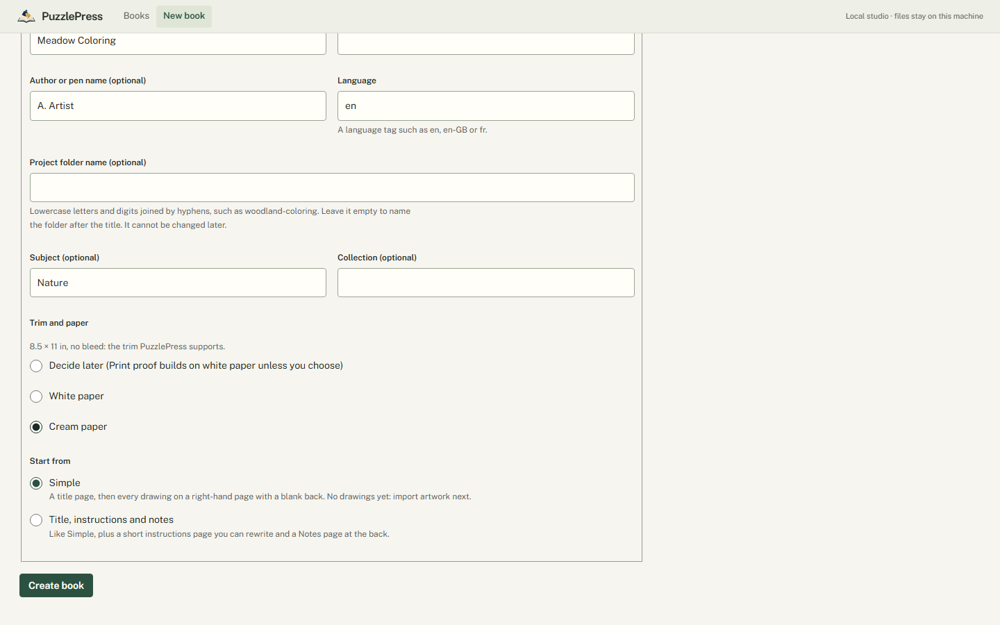
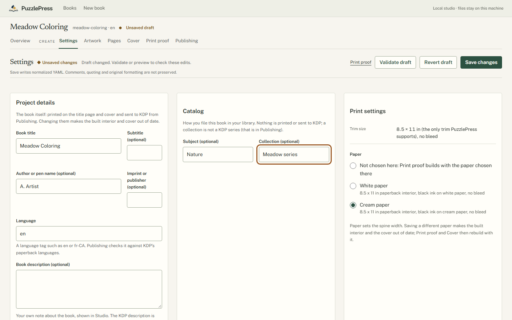
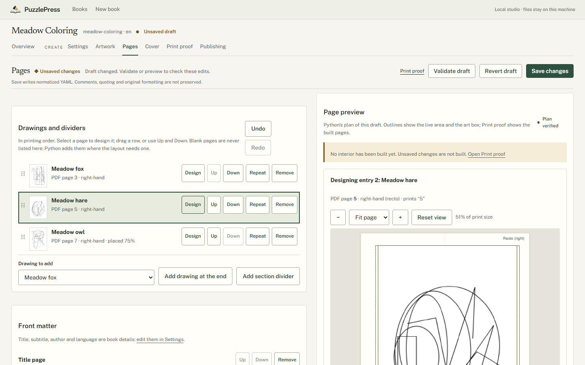
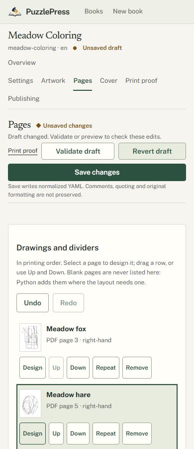
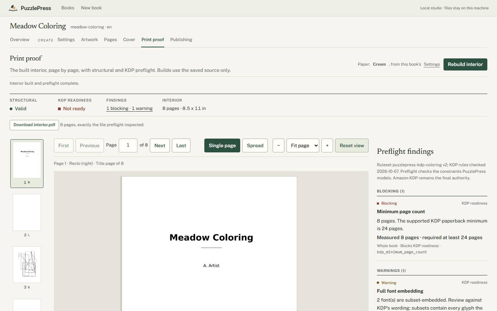

# Making a coloring book in Studio, without YAML

This walks through one coloring book from nothing to an upload package using only
Studio (`puzzlepress-studio --books DIR`, then http://127.0.0.1:8000/books). Every
step writes `book.yaml` for you through the same Python checks as the CLI; you never
need to open it. PuzzlePress never contacts or submits anything to Amazon.

## 1. New book

Choose **New book**. Pick **Coloring Book** (word search is the other type; maze,
crossword, sudoku and the rest are listed as not available yet). Enter the title,
and if you like a subtitle, your author or pen name, a subject and a collection.
Choose the paper now (white or cream; the trim is 8.5 x 11 in) or decide later, and
a starting point: **Simple** (a title page) or **Title, instructions and notes**.
**Create book** makes the project folder and opens its Artwork page. If the folder
name is taken, Studio says so beside the field and keeps what you typed.

A new coloring book has no drawings. Its Overview says it cannot pass the print and
publishing checks yet, and lists the steps below.

## 2. Settings

**Settings** holds what the book is: title, subtitle, author, imprint, language and
a description for yourself; the subject and collection you file it under; and the
paper. KDP's own description, keywords and declarations are in Publishing. Saving a
new paper makes a built interior and cover out of date, so they are rebuilt with it.

## 3. Artwork

**Import artwork** takes PNG or JPEG line art, several at once. Studio copies each
original unchanged, adds it to the pages and reports its print resolution and
problems (color, gray paper, transparency, edges, look-alikes). **Prepare line art**
adjusts contrast, cleanup, despeckle, threshold or line weight with original,
prepared and difference views; the original is never changed.

## 4. Pages

**Pages** lists every drawing and divider in printing order, with the PDF page and
side each lands on. Drag a row, or use **Up** and **Down**. **Design** opens a page:
zoom (Fit page, Fit width, up to 400 %), pan by dragging, replace its drawing, make
it smaller and move it inside its printable area, duplicate it, or insert a section
divider after it. Below are the title, copyright and instruction pages, the back
matter, blank backs, border and page numbers. **Undo** and **Redo** (Ctrl+Z,
Ctrl+Shift+Z) step through unsaved changes; **Save changes** writes them.

The preview on the right is Python's plan: every physical page as spreads, the
blank pages added behind drawings or to start on a right-hand page, and the printed
numbers.

## 5. Print proof

**Build interior** makes the PDF you would upload and checks it (page sizes,
margins, every drawing whole and lossless, 300 DPI, parity, line quality). Turn
pages, view spreads, zoom (Fit page, Fit width, 50-300 %), drag to pan and turn on
overlays for the live area, margins and findings. **Download interior.pdf** saves it.

## 6. Cover and Publishing

**Cover** is sized from the built interior's page count and paper; apply a template
and import a cover drawing or photograph. **Publishing** asks for the KDP details,
who made the artwork and on what basis you may publish it, and your confirmations;
nothing is preselected. When nothing blocks, **Export package** writes the files you
upload to KDP yourself. `puzzlepress book produce` makes the same package in one
verified run.

## Before you submit

Look at every page at print size, keep the evidence behind your rights
declaration, and order a printed proof: thin and light lines print differently on
paper. PuzzlePress's line-quality thresholds were set on synthetic drawings; see
[coloring-publishing.md](coloring-publishing.md#real-artwork-review).
